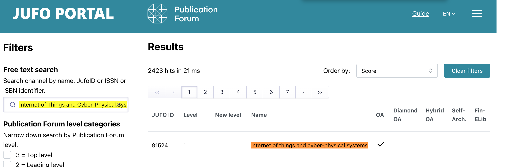

# MUSTA LINNA

## Research article

[Read the article on ScienceDirect](https://www.sciencedirect.com/science/article/pii/S2667345226000076)

## Review of Generative AI methods in cybersecurity article

This is the article I find interesting, it is a review article with JUFO rating 1 and it is fresh, from year 2025

## JUFO Level 1

The article is published in *Internet of Things and Cyber-Physical Systems*, which is classified as **JUFO Level 1** (basic level) in Finland's Publication Forum. The screenshot shows the journal's JUFO ID **91524** and Level **1** classification. JUFO classifies publication channels rather than individual articles.

## Review the review

It is pretty interesting to see how general and superficial the ideas in this review are compared to what we see in late 2026. AI is moving too fast, and this gives bad actors plenty of opportunities to use it for criminal activities.

In my opinion, bad actors will continue trying to exploit the weakest points, such as the ethical limitations of AI agents. They may also try to place insiders in key companies, since humans will always be the weakest point in any defence system.

1. What are the key areas being researched?

That review looks at AI from two perspectives, attack and defence. On attack, it covers both attacks on the AI itself like jailbreaking, prompt injection, reverse psychology but also
AI used for cybercrime like phishing, social engineering, malware, payloads, reverse cryptography. On defence, GenAI helps automate dataset building, threat intelligence, and attack detection. A final part covers ethics, law and society.

2. What's widely agreed upon?

- AI strengthens defence but also opens new attack routes
- Safety filters can be broken, even with ethics safe measures
- LLMs should assist experts, not replace them
- Hallucination of LLMs is still significant concern

3. What are the open questions?

- Dark tools like WolfGPT, XXXGPT and WormGPT exist, but nobody has measured their real offensive power
- The real trend is jailbreaking mainstream models, not building new ones
- Law and ownership lag behind, as AI and human work blur together
-  Main future focus to build strong ethical norms and new defences, with interdisciplinary work

## Threat modeling quickrun Jewellery Shop

Jewellery Shop - the most important things for the shop are gold and diamonds, cash, customer database (names and addresses of rich people).

---

## Risk 1 – Armed Robbery

**What criminals want:** Gold, diamonds and other expensive jewellery that can be sold. Especially now, when gold prices are rising.

**How:** Criminals can break display windows during the day or threaten employees when the shop is closing.

**Why us (COI):**

- **Capability:** criminal groups have experience with jewellery robberies, easy to resale or transfer
- **Opportunity:** expensive jewellery is visible from the street. The shop has regular opening hours and sometimes only one employee, woman
- **Intent:** Very high, because gold prices are rising and stealing gold can bring more money to criminals

**Impact:** Around €180 000 = stolen jewellery €150 000 + repairs €20 000 + lost sales €10 000

**Likelihood:** Around 8% per year

**Estimated annual loss:** 0.08 × €180 000 = €14 400/ year

---

## Risk 2 – Customer Database Exposed

**What criminals want:** Customer names, addresses and possibly payment information. This information can also be used to find wealthy customers and rob their homes,  and the shop won't even know that its database was used

**How:** Phishing emails, stolen passwords or weak security on the website or payment system.

**Why us (COI):**

- **Capability:** Hackers can use existing phishing and ransomware tools
- **Opportunity:** Small shops usually do not have strong IT and data security
- **Intent:** Moderate to high, because customer information can be valuable for criminals

**Impact:** Around €90 000 (possible GDPR law cases, fixing the problem and losing customers)

**Likelihood:** Around 12% per year.

**Estimated annual loss:** 0.12 × €90 000 = €10 800/year

---

## Biggest Risk – Armed Robbery

The biggest risk is armed robbery, with an estimated annual loss of **€14 400**.

## Decision – META: Mitigate + Transfer

**Mitigate:** We can reduce the risk by keeping expensive jewellery in a safe during the night. Instead of real jewellery, we can put cheap jewellery from China in the display windows after closing. This way the shop still looks attractive, but criminals cannot steal expensive products from the windows at night.

We can also install cameras, alarms and stronger display windows. Employees should not open or close the shop alone.

**Transfer:** We should also buy insurance that covers stolen jewellery, damage to the shop and lost income if the shop needs to close for some time.

### Why not eliminate or accept?

We cannot completely eliminate this risk without closing the shop. One serious robbery could create big financial problems.
For this reason, I think the best solution is to **reduce the risk and use insurance for the remaining risk**.

---

# REFERENCE
Karvinen (2023): https://terokarvinen.com/review-article/

