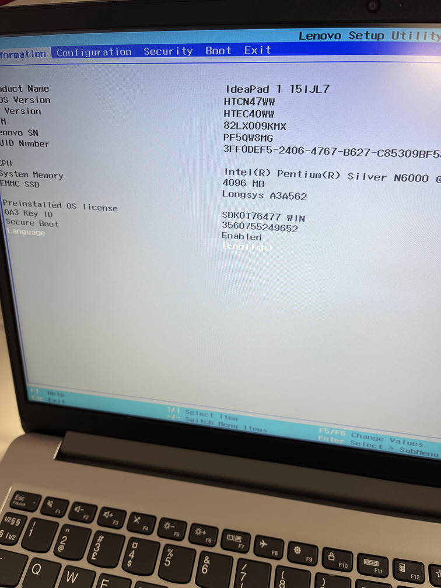
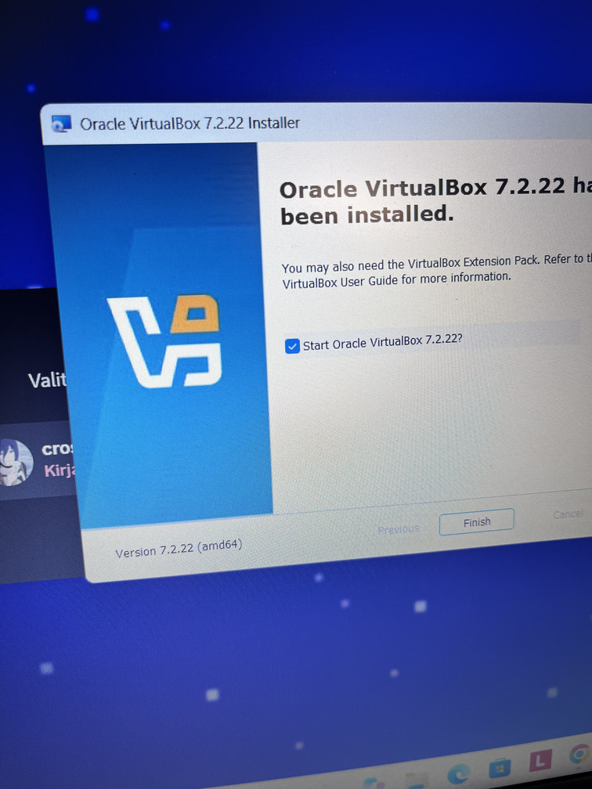
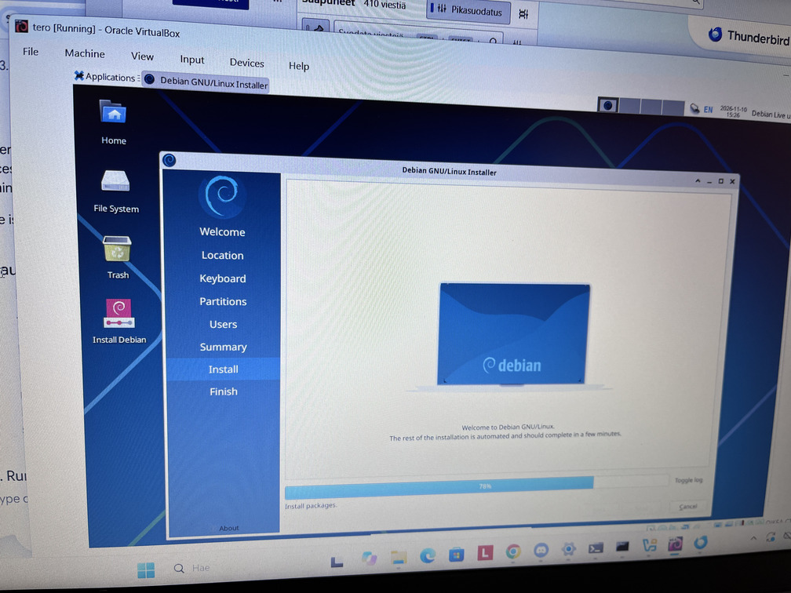

# MUSTA LINNA

## x) Read/watch/listen and summarize

Pretty nice detailed installation instructions here
Heinonen 2026: How to Install Linux to Virtualbox?

Karvinen 2020: Command Line Basics Revisited
good overview on command promit, nothing speacial to add

# a)  Mindcraft

# b) Linux. Install Linux on a virtual machine. Use Debian 13-Trixie.

I bit slow process, took a few days to install, since machine is pretty basic.

debian-live-13.6.0-amd64-xfce.iso link is broken here
https://github.com/johannaheinonen/johanna-test-repo/blob/main/module_1.md

Installation went ok,  nithing speacial based on  Johanna Heinonen notes

# c) Crack. Crack the hash 6b1628b016dff46e6fa35684be6acc96 . Install hashcat and follow the steps in the article to crack the example hash. Karvinen 2022: Cracking Passwords with Hashcat.

hashcat -m 0 '6b1628b016dff46e6fa35684be6acc96' rockyou.txt -o solved

6b1628b016dff46e6fa35684be6acc96:summer

