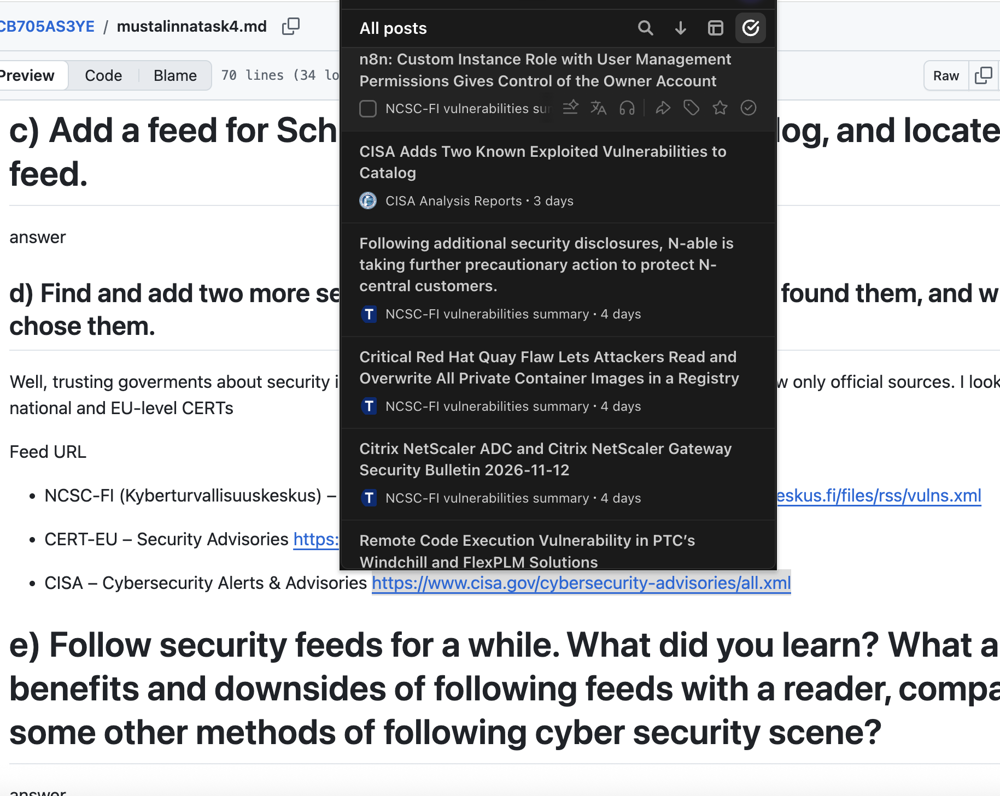
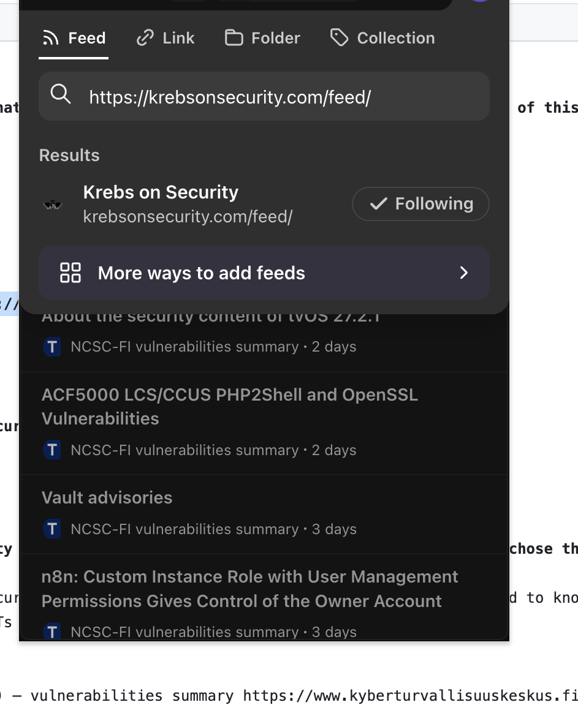
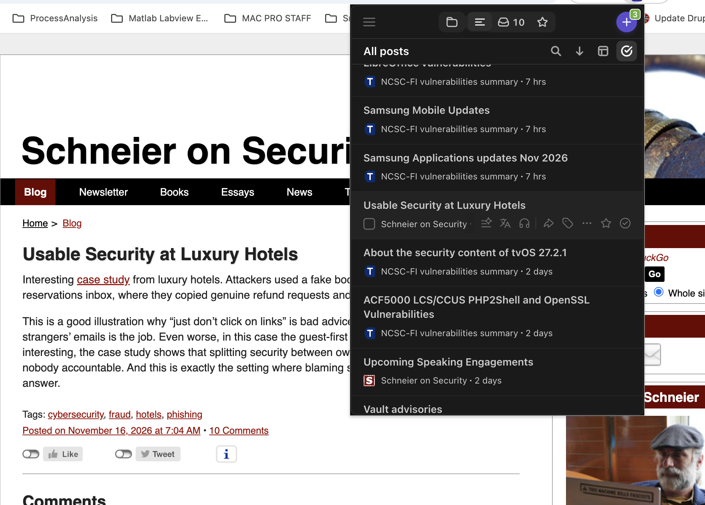

# MUSTA LINNA

## x) Why would you want to use a feed reader (and RSS/Atom)?

- Mainly because no personalization or any other advanced filters apply to those lists. Also aggregator saves time 
no need to check many sources.  Of course no noise, no banners, no ads, no cookie madness.

## y) Supreme court of Finland, case Osuuspankkikeskus port scan KKO:2003:36. Have a brief look, summarize the key thing in a couple of bullets or sentences

In 2003 the Supreme Court of Finland decided case mentioned above. A teenage boy used a program to scan the network of Osuuspankkikeskus . He was looking for open proxy servers. The scan did not go through the firewall, so he did not get inside but the court said he was guilty of attempted computer break in and he had to pay damages.

- Port scanning without permission can be a crime in Finland, even if you do not get in
- The court said the program was clearly made for this, so it was not believable that he used it for something harmless
- Motive was not important. The crime does not need a special purpose
- He also had to pay damages to the bank
- It was not important that he did not know the target was a bank
- The court trusted the IP address as evidence. It did not accept the idea that somebody faked it

## a) Install a feed reader. Show that it can read a feed (RSS or Atom). Include a screenshot of this.

Following security related feeds

## b) Add the feed for Krebs. https://krebsonsecurity.com/feed/

Following Krebs

## c) Add a feed for Schneier on Security. Find the blog, and locate the feed.

Following Schneier on Security, https://www.schneier.com/feed/

## d) Find and add two more security related feeds. Explain how you found them, and why you chose them.

Well, trusting goverments about security issues, so didn't try to find anything else,  wanted to know only official sources. I looked for official national and EU-level CERTs

Feed	URL
- NCSC-FI (Kyberturvallisuuskeskus) – vulnerabilities summary	https://www.kyberturvallisuuskeskus.fi/files/rss/vulns.xml

- CERT-EU – Security Advisories	https://cert.europa.eu/publications/security-advisories-rss

- CISA – Cybersecurity Alerts & Advisories	https://www.cisa.gov/cybersecurity-advisories/all.xml

## e) Follow security feeds for a while. What did you learn? What are the benefits and downsides of following feeds with a reader, compared to some other methods of following cyber security scene?

- I saw how many new vulnerabilities come out every day, in products like Citrix NetScaler, GitLab, PHP, LibreOffice and Samsung phones. Many of them are critical. Attackers are fast too for example, SANS ISC reported scans for new LiteLLM vulnerabilities soon after they were published, so patching quickly is very important. The benefit of a feed reader is that everything comes to one place automatically, in time order, and only from sources I chose.

## f) Port scan. How can criminals know what services your employer has? Disconnect your computer from the internet while doing the test (after you have installed the required software). Do the test inside your virtual machine.

- criminals use a port scanner like nmap, it shows which ports are open and which program and version is running on them then they look for known bugs in that version. They can also look on sites like Shodan, which scan the whole internet all the time
