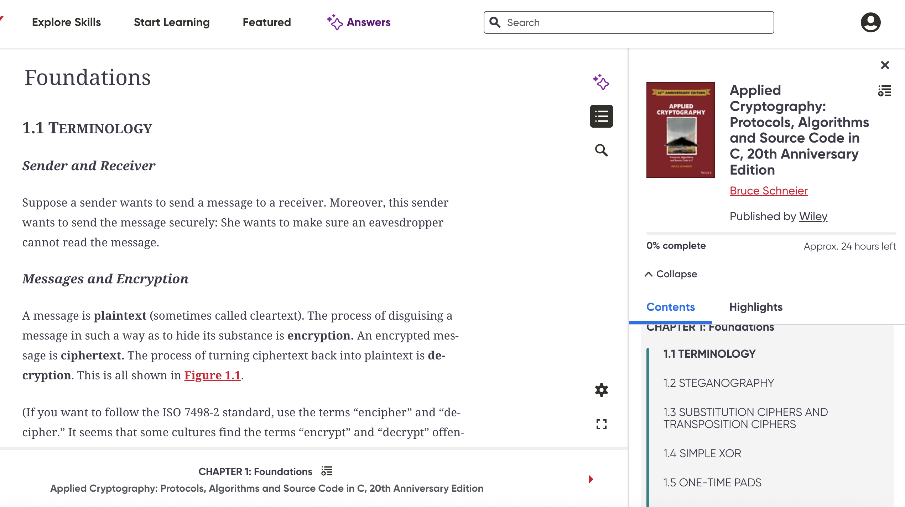
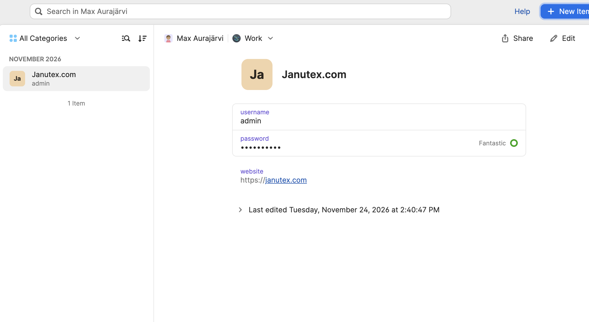

# MUSTA LINNA

## x) Read and summarize

# Schneier 2015: Applied Cryptography, Chapter 1.1 Terminology

Cryptography is about a sender who wants to send a message to a receiver so that nobody else can read it. The normal message is called plaintext. Encryption turns it into ciphertext, which looks like random data, and decryption turns it back into plaintext. Cryptography can also prove who sent a message (authentication), show that nobody changed it (integrity), and stop the sender from later denying that they sent it (nonrepudiation).

The algorithm, or cipher, is the math used for encrypting and decrypting. Old algorithms were secure only if the algorithm itself stayed secret, and that is a bad idea. Modern algorithms use a key, so the algorithm can be public and all the security is in the key. In symmetric algorithms the same key is used to encrypt and decrypt, so both people must share the secret key before they can talk. In public-key (asymmetric) algorithms there are two different keys: anyone can encrypt with the public key, but only the owner of the private key can decrypt.

# Schneier 2015: Chapter 2.5 Communications Using Public-Key Cryptography

Schneier compares symmetric crypto to a safe, where everyone needs the same combination, and public-key crypto to a mailbox. Anyone can put a letter in the mailbox, but only the owner with the key can take it out. When Alice wants to send a secret message to Bob, she gets Bob's public key and encrypts the message with it, and Bob decrypts it with his private key. They don't need to meet and share a secret key first, and this solves a big problem of symmetric crypto.

In real life, public-key crypto is slow and has some weaknesses, so it is not used to encrypt the whole message. Instead, Alice makes a random session key, encrypts it with Bob's public key, and sends it to Bob. After that they both use this session key with a fast symmetric algorithm. This is called a hybrid cryptosystem, and tools like GPG and SSH work this way. Schneier also tells about Merkle's puzzles, the first public-key idea from 1974. It made the attacker do much more work than Alice and Bob.

## a) Pubkey today. Explain how you have used public key cryptography today or yesterday, outside of this homework. In addition to naming the system, identify how different parties use keys in different steps of the system. (Answering this question likely requries finding sources on your own. This subtask does not require tests with a computer.)

Yesterday I used SSH to connect from my laptop to my web server at janutex.com. When I connected the server and my laptop first did a Diffie Hellman key exchange. 

ssh admin@janutex.com

Each side sent the other a temporary public key, and both used them to calculate the same shared secret, which then encrypted the session. The server proved it was really janutex.com by signing the exchange with its private host key.

~/.ssh/known_hosts

My laptop checked that signature with the server's public host key, which it had saved in known_hosts the first time I connected. Then I proved who I was by signing a message with my private key, which never leaves my laptop. The server checked that signature with my public key, which I had added to its authorized_keys file earlier. 

Because of this, I could log in securely without sending a password over the network.

## b) Encrypt and decrypt a message. Explain how different parties use different keys at different stages of operation. Evaluate the security of the tool you've chosen.

My machine's hardware failed for some reason after running virtual machine, windows machine, had to do tasks differently

## c) Password management. Demonstrate use of a password manager. What kind of attacks take advantage of people not using password managers? (You can use any password manager, some examples include pass and KeePassXC.)

I use 1Password as my password manager. In the screenshot you can see I saved the login for my web server, Janutex.com, in my "Work" vault. It has the username "admin", a long random password that 1Password made for me (it says the strength is "Fantastic"), and the website address https://janutex.com. I don't need to remember this password. I only remember one master password, and on my Mac I can unlock 1Password with Touch ID. Then the browser extension fills in the login for me. I chose 1Password because I use Mac a lot and it works very well there. It has a nice Mac app and Touch ID, it works in Safari and Chrome, and it syncs to my iPhone too. It also tells me if a password is weak, reused, or was leaked in a data breach.

People who dont use a password manager often use the same simple password everywhere. Attackers can take advantage of this in a few ways:

- a fake website looks like the real one and you type your password there. 1Password only autofills on the real domain so if it doesn't fill, that's a warning sign
- when one website gets hacked, attackers try the leaked username and password on other websites. If you reuse your password they get into your other accounts too.
- short or common passwords like "mydogname" are easy to guess with programs that try many passwords. A long random password from a password manager is almost impossible to guess
- people without a manager often keep passwords on paper or in a text file and anyone who finds it can read it
